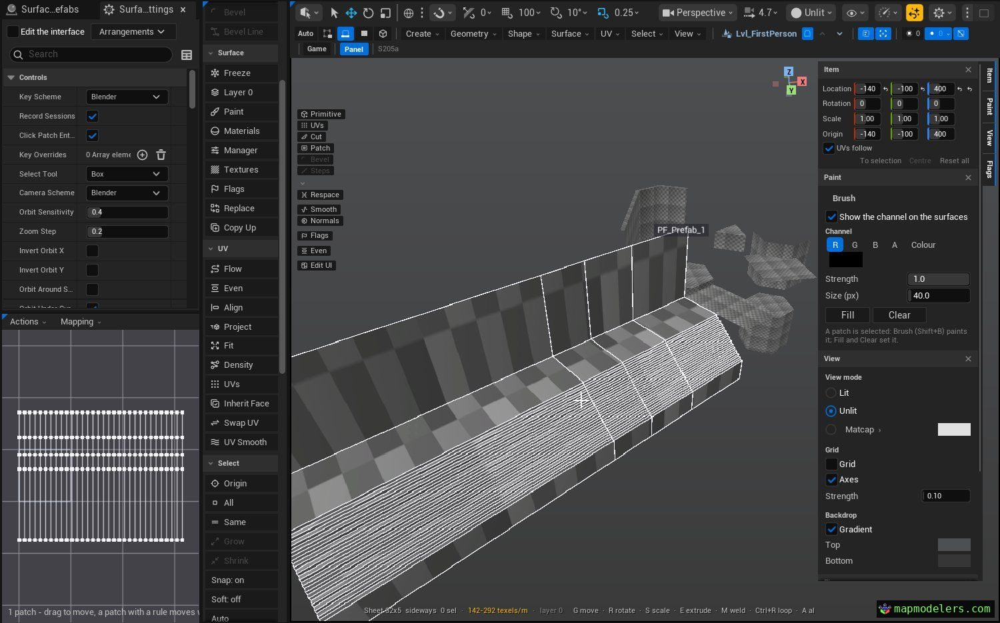
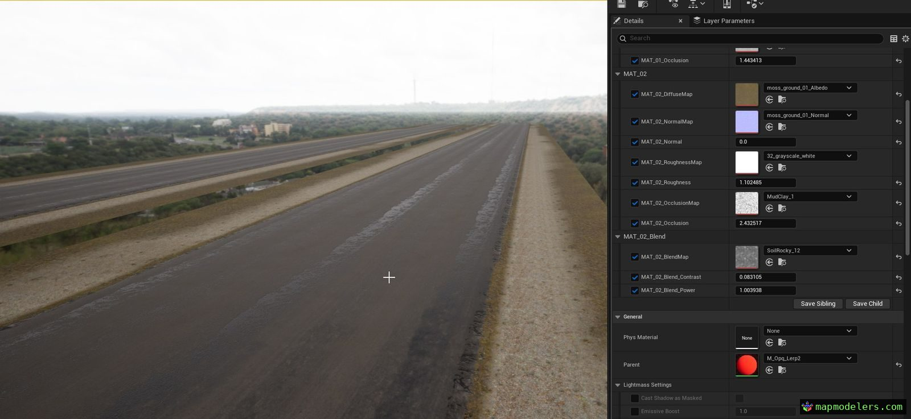

# SurfacingPro

> **Experimental, in progress.** Built with AI. Prebuilt for Unreal Engine 5.8 (Win64) in [Releases](https://github.com/mapmodelers/SurfacingPro/releases); more engine versions soon.

The source is public and built with AI. To adapt it to your own pipeline, AI is the recommended way.

**Surface modeling solution in Unreal Engine 5 with PBR Blend Shading and Decals.**

## Features

- Modeling patches
- Permutable PBR shaders
- Ordering material layers
- Nested hierarchies with Prefabs and Level Instances
- Custom UIs

## Install

Tested on Windows 10, Unreal Engine 5.8.3. Back up your project first.

1. [Releases](https://github.com/mapmodelers/SurfacingPro/releases) zip → `<YourProject>/Plugins/SurfacingPro`.
2. Open the project. Mode toolbar → **SurfacingPro**.

From source: C++ project, Visual Studio 2022.

[User guide](SurfacingPro/Docs/UserGuide.md) · [Documentation](https://docs.mapmodelers.com/surfacingpro/) · [Specifications](docs/SPECS.md)

## Bugs

[Issues](https://github.com/mapmodelers/SurfacingPro/issues), with your UE version and the steps. Feedback and ideas: [Discussions](https://github.com/mapmodelers/SurfacingPro/discussions).

Debug notes: in the mode, press **X**, type a line and press Enter. It goes into the session record with what you were doing. The record stays on your PC, in `<YourProject>/Saved/SurfacingPro/Sessions/` (turn it off with **Record sessions** in Editor Preferences › Plugins › SurfacingPro). It holds your asset names, so email the newest file to [support@mapmodelers.com](mailto:support@mapmodelers.com) rather than posting it.

Updates: on GitHub, **Watch → Custom → Releases**.

## AI

Code generated with AI, directed and tested by MapModelers. This is an AI repository: specifications, conventions and source are written for models to read. Pointing an AI at it to continue or study the tool for your own use is encouraged, within the license. AI agents: start with [AGENTS.md](AGENTS.md).

## License

Free for individuals, education, and organizations under 50 staff and €10M turnover, on projects under €1M budget. Larger organizations or budgets: [support@mapmodelers.com](mailto:support@mapmodelers.com). Terms: [LICENSE.md](LICENSE.md).
